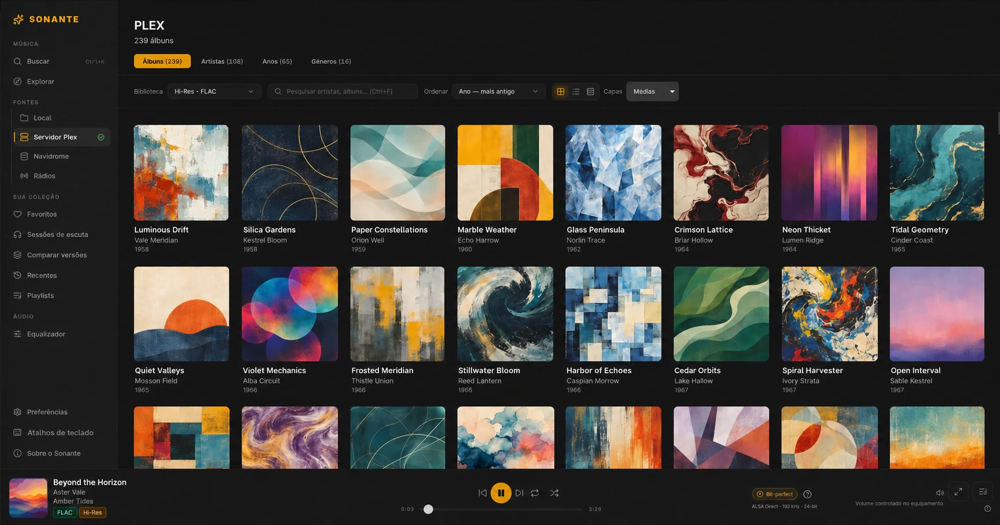
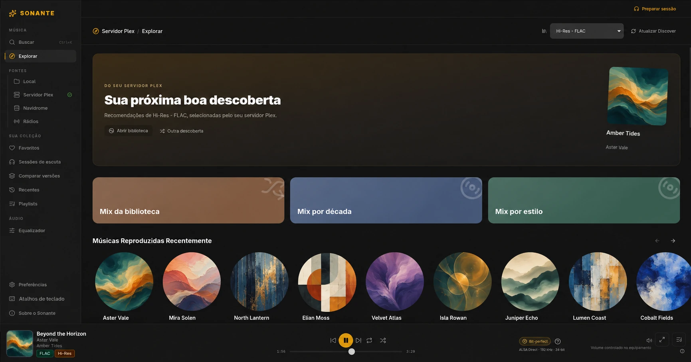
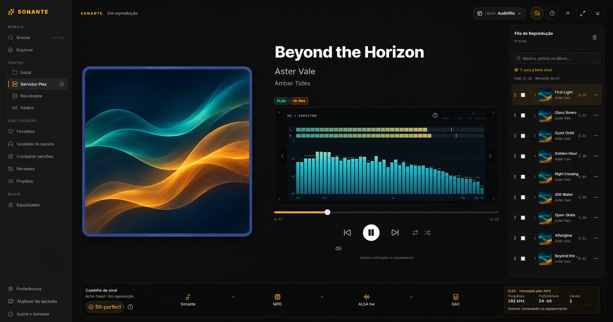

# Sonante

### Your music. Your way.

**Your music collection, all together.**

A modern, open-source music player for enjoying your own albums, Plex and Navidrome in one place.

[**Explore the website**](https://tiagoalam.github.io/Sonante/) · [**Download Sonante**](https://github.com/tiagoalam/Sonante/releases/latest) · [**Get started**](docs/GETTING_STARTED.md)

**Available for Linux** · Windows in development

## More music. Less searching.

Your albums deserve more than a folder list. Sonante brings your collection together, whether it's stored on your computer, a network drive, Plex or Navidrome.

Browse your favorite artists, rediscover forgotten albums and spend more time listening.

| Discover | Enjoy | Make it yours |
| --- | --- | --- |
| Explore albums, artists, decades and genres. | Build queues and playlists, save favorites and discover new combinations of music you already own. | Choose your themes, cover layouts, Now Playing views, and Simple or Full mode. |

  
  

## What can Sonante do?

- **Bring your libraries together:** local folders, mounted shares, Plex and Navidrome.
- **Rediscover your collection:** Explore, suggestions, albums, artists, genres and decades.
- **Create your own listening experience:** queues, favorites, manual playlists and smart playlists.
- **Customize your player:** Simple and Full modes, six themes, library layouts and immersive Now Playing screens.
- **Look after your music:** local album diagnostics and reviewed FLAC metadata editing.
- **Choose how to listen:** Shared and Direct audio-output options, audio-device selection and playback controls.
- **Go further when you want:** online radio, Last.fm and ListenBrainz, and optional advanced features.

Some features are specific to certain music sources or interface modes. [See all the details](docs/LINUX_GUIDE.md).

## Download Sonante

**The latest Linux release is v0.6.3.**

[**Get the latest release for Linux**](https://github.com/tiagoalam/Sonante/releases/latest)

| Distribution | Download |
| --- | --- |
| Ubuntu 22.04 | `.deb` |
| Fedora 44 | `.rpm` |
| Arch Linux / Manjaro | `.pkg.tar.zst` |

Download the package that matches your distribution and install it using your package manager. The latest release also provides a checksum file for download verification.

**Windows is being developed** and isn't part of the current public release. Other platforms are not available yet.

[New to Sonante? Start here.](docs/GETTING_STARTED.md) · [Installation requirements](docs/LINUX_GUIDE.md#system-requirements)

## A player that fits the way you listen

**Simple mode** puts everyday listening first.

**Full mode** opens more ways to explore your collection, build smart playlists and customize your experience. Advanced experimental features remain optional.

Switch between modes without losing your music collection, playback state or saved preferences.

## Help shape Sonante

Sonante is open source and actively evolving. If you try it, we'd like to know how it works with your distribution, music library and audio setup.

[**Report a problem**](https://github.com/tiagoalam/Sonante/issues/new/choose) · [Release notes](RELEASE-NOTES.md) · [Full Linux documentation](docs/LINUX_GUIDE.md)

Please review logs and screenshots before posting them publicly, and remove any personal information or credentials.

---

<strong>For developers and technical readers</strong>

Sonante is built with React, TypeScript, Tauri and Rust. Linux playback uses a supervised private MPD engine and ALSA.

- [Detailed Linux guide, requirements and source builds](docs/LINUX_GUIDE.md)
- [UPnP receiver](docs/UPNP_RECEIVER.md)
- [Remote-control API](docs/remote-control-api.md)
- [Gapless validation notes](docs/GAPLESS_VALIDATION.md)
- [Third-party notices](THIRD_PARTY_NOTICES)

**License:** [GNU GPL v3.0](LICENSE)
